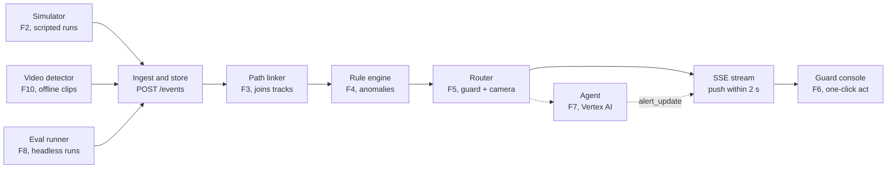

# Tech Spec: Community Early-Warning Safety Network

> Markdown transcription of `docs/Tech_Spec_Community_Early_Warning_Network.pdf` (Oct 16, 2026, @Sky Lee).
> This file is the working copy agents read; the PDF is the frozen original.

Oct 16, 2026 · @Sky Lee

## 1. Overview and Assumptions

This spec describes how to build the prototype defined in the PRD for the Sime Darby Property University Hackathon 2026. Must features F1 to F8 ship in the 23 Oct submission; Should features F9 to F13 follow in the final submission after the Top 10 announcement. Feature IDs match the PRD.

Assumptions to confirm:

- The prototype uses simulated scenarios and licensed public video only. There is no real CCTV connection.
- It is a web app, and the 5-minute demo is a recording.
- One community is enough, but every table carries a `community_id` so a second one needs no schema change.
- There is no real login. Users pick a seeded role and name (supervisor or guard). The audit log (F12) still gets a user.
- Team size is not known. The phases in section 8 assume 2 to 3 developers working in parallel; if the team is smaller, use the cut lines there.

## 2. Tech Stack

Python backend, React frontend, PostgreSQL, Google Cloud for hosting and the agent. One backend language keeps the simulator, rules, evaluation and Vertex AI client together.

| Layer | Choice | Why |
|---|---|---|
| Frontend | React 19, TypeScript, Vite, Tailwind, TanStack Query, Zustand | Fast to build; types generated from the API schema |
| 2D map editor | react-konva (canvas) over an optional background image | Drag, link and highlight nodes without a GIS stack; 2D is enough (PRD decision) |
| Backend | Python 3.12, FastAPI, Pydantic v2, uvicorn | One language for API, simulator, rules, evaluation and the Vertex AI client |
| Graph logic | networkx | Shortest walking time (Dijkstra) and neighbour lookup on the camera graph |
| Database | PostgreSQL 16, SQLAlchemy 2, Alembic | Relational model with jsonb for event attributes; migrations from day 1 |
| Realtime | Server-Sent Events (SSE) | One-way push of events and alerts fits the 2-second alert target; simpler than WebSockets |
| Agent | Google Vertex AI (Gemini family, exact model set in PRD Q6), google-genai SDK, function calling, JSON-schema output | Platform decision from the PRD; tool calls keep the agent away from raw video |
| Detection (Should, F10) | Ultralytics YOLO with ByteTrack, OpenCV, ffmpeg | Off-the-shelf detector and tracker; runs offline and outputs events JSON |
| Learned baseline (Should, F13) | pandas, scikit-learn | Per-camera, per-hour counts and transitions; no deep model needed |
| Tests | pytest, Vitest, Playwright | Unit tests on pure logic; Playwright follows the demo script |
| Tooling | uv (Python), pnpm, Docker Compose, GitHub Actions | One command to run locally; CI blocks merges that break tests |
| Hosting | Frontend on Vercel; backend on Google Cloud Run; PostgreSQL on Neon | Two independent deploys, each with its own URL and environment variables; the backend calls Vertex AI as its Cloud Run service account, so no key is stored |

## 3. System Architecture

Every source writes the same event format into one pipeline. The pipeline links events into paths, checks rules, routes alerts, and asks the agent to rank and explain them. The evaluation runner replays scenarios through the same code, so the demo and the numbers cannot drift apart.

**Every source feeds one event format and the engine turns it into a guard alert**



PostgreSQL holds events, tracks, alerts and timelines. The agent reads it only through tools.

*Pipeline architecture · 3 sources, 1 event format, 1 alert path.* The simulator, video detector and eval runner all post the same events. The alert reaches the guard console as soon as the router finishes, with a provisional rule-based severity; the agent's severity and reason follow as an `alert_update` (D-61).

### Design decisions

1. **One event contract.** The simulator (F2) and the video detector (F10) both post the same event JSON. Stages F3 to F7 read only from the event stream.
2. **Event time, not wall time.** Each event carries `ts`. The pipeline runs on a simulated clock, so a scenario gives the same alerts on every run (PRD: reproducible).
3. **Pure functions at the core.** Path linker, rule engine, router and next-camera scoring take data in and return data out. This makes them unit-testable and lets `make eval` run without a server.
4. **The agent works through tools only.** It can call `get_neighbors`, `get_track`, `get_events`, `get_guards` and `get_alert`. It never sees pixels or raw video.
5. **Timeline validator.** Every timeline entry must cite event IDs that exist in the stream. Entries that fail are dropped or rewritten as an explicit "cannot be determined" entry (PRD F7).
6. **Privacy by construction.** No image bytes are stored. Objects carry a per-camera local ID and a pseudonymous `anon_id` with an `expires_at`; a purge job deletes expired tracks.

### Components

| Component | Responsibility | Reads | Writes |
|---|---|---|---|
| Layout service (F1) | Edit nodes, links and walking times; import and export JSON | node, link | node, link |
| Simulator (F2) | Replay a scenario file as timed events | scenario file | event (via ingest) |
| Ingest | Validate and store events, push to the pipeline | event payload | event |
| Path linker (F3) | Join per-camera fragments into tracks | event, link | track, track_segment |
| Rule engine (F4) | Evaluate rules on tracks | track, rule_config, baseline | anomaly |
| Router (F5) | Pick the nearest on-duty guard and the next camera | anomaly, guard, link | alert |
| Agent service (F7) | Severity, reason, incident timeline | alert, tools above | alert, timeline_entry |
| Stream (F6) | Push events, track updates and alerts over SSE | all of the above | none |
| Eval runner (F8) | Replay scenarios headless; compute metrics and the baseline | scenario, truth path | eval_result |

### Key algorithms

- **Path linking.** When an object leaves camera A, open a candidate window on each linked camera B from `exit_ts + travel_min_s × class factor` to `exit_ts + travel_max_s`; the factor is 1.0 for a person and 0.3 for a vehicle, because link times are walking times (D-55). An appearance at B inside the window is joined to the track, choosing the best time fit when several objects compete. No match, or an appearance at an unlinked camera, starts a new track. A track closes when no linked appearance arrives within its last node's largest outgoing `travel_max_s`, and expires 24 h after its last sighting (D-56). Only object class and timing are used, never face features.
- **Anomaly rules (human-defined).** Rules run in the community's time zone (D-54). After-hours entry: a track appears in a lane zone during the quiet period, 23:00–06:00. Loitering: a track's cumulative time in one zone within a rolling window reaches a threshold (180 s within 10 min); the time counts each sighting in the zone and each gap between consecutive sightings that are both in it (D-52). Off-route: a transition that no seeded normal route contains (D-53); in Phase 2, also one the learned baseline marks as rare. All thresholds live in `rule_config`.
- **Alert routing.** Dijkstra over link weights, (`travel_min_s` + `travel_max_s`) / 2, from each on-duty guard's node to the event node; guard positions come from the scenario's roster (D-58). The shortest wins. If no guard is on duty, the alert is escalated to the supervisor. A track has at most one open alert per rule; a repeat match adds evidence to it (D-59). Severity starts from a rule-based mapping (D-60).
- **Next-camera suggestion.** Score each neighbour of the track's current node by direction of travel, no immediate backtrack, walking time and the transition's share of normal routes, with weights in config (D-57); in Phase 2, also the learned baseline. Return the top camera with the factors that produced it. The score never reads the scenario's true path.
- **Evaluation baseline.** Model guards checking N screens in turn with a fixed dwell time per screen. Time to alert is the wait until the guard's current screen shows the camera where the event occurs. Parameters sit in config (PRD Q1).

## 4. Data Model

19 PostgreSQL tables (17 core, 2 added by F12). All have a UUID primary key and `community_id` where it applies; timestamps are `timestamptz`. Nothing in the schema stores an image, a face feature or a name that belongs to a member of the public.

| Entity | Key fields | Notes |
|---|---|---|
| community | name, map_image_url, scale_m_per_px, timezone, normal_routes (jsonb) | One seeded community for the prototype; `normal_routes` holds named node-code sequences for the off-route rule and next-camera scoring (D-53) |
| zone | community_id, code, name, kind (street, gate, lane), polygon | Used by loitering and after-hours rules; `code` is unique per community (D-75) |
| node | community_id, code, kind (camera, sensor), name, x, y, heading_deg, status (online, offline), zone_id | Offline status drives F9; `code` is unique per community (D-75) |
| link | community_id, from_node_id, to_node_id, travel_min_s, travel_max_s, bidirectional | Unique on (from, to); check from is not to (F1 rejects self and duplicate links) |
| app_user | community_id, code, name, role (guard, supervisor), on_duty, current_node_id | Seeded; the role picker uses this table; `code` is unique per community (D-75); a run sets `on_duty` and `current_node_id` from its scenario's roster (D-58) |
| scenario | community_id, code, name, description, script_path, duration_s | Ground truth — true path, expected alerts and timeline — stays in the script file, never in the database (D-70) |
| scenario_run | scenario_id, mode (live, eval), speed, state, started_at | One row per playback or evaluation |
| event | community_id, run_id, ts, node_id, type (appear, disappear, dwell), object_class (person, vehicle), local_track_id, attrs (jsonb), source (sim, video) | The single contract between sources and the pipeline; `attrs` holds no personal data |
| track | community_id, run_id, anon_id, first_ts, last_ts, expires_at, status (active, closed, expired) | A track is one anonymous cross-camera path |
| track_segment | track_id, node_id, enter_ts, exit_ts, event_ids (uuid[]) | Ordered segments make up the path |
| rule_config | community_id, rule_key (after_hours, loiter, off_route), params (jsonb), enabled | Editable without code changes (F4) |
| baseline_profile | node_id, hour_bucket, mean_count, std_count, transitions (jsonb) | Learned normal movement (F13) |
| anomaly | track_id, rule_key, ts, evidence_event_ids (uuid[]), score | Rule name and evidence are mandatory; `track_id` is cleared when the track expires (D-56) |
| alert | anomaly_id, status (new, acked, dismissed, escalated), severity (high, medium, low), severity_reason, triage_status (pending, agent, fallback), assigned_user_id, next_node_id, next_node_basis (jsonb), created_ts, acked_ts | Severity starts rule-based and provisional (`pending`); the agent's severity and reason replace it, or the rule-based value stays after the timeout (`fallback`) (D-60, D-61) |
| alert_action | alert_id, user_id, action (confirm, dismiss), reason, ts | Written to the incident timeline as well |
| timeline_entry | alert_id, ts, kind (fact, unknown, action), text, event_ids (uuid[]) | `fact` entries must cite at least one existing event; `action` entries record the guard's confirm or dismiss (D-62) |
| eval_result | run_id, metric, value, baseline_value | Metrics: time_to_alert, next_cam_accuracy, false_alerts_per_cam_night, timeline_match |

F12 adds `audit_log` (user_id, action, target_type, target_id, ts) and `retention_policy` (community_id, track_ttl_s, event_ttl_s).

Relationships: community has many zones, nodes, links, users, scenarios. A scenario run has many events. Events join into tracks through track_segment. A track has many anomalies. An anomaly has one alert. An alert has many actions and timeline entries.

## 5. API Design

REST over JSON under `/api/v1`, plus one SSE stream for live updates. IDs are UUIDs, timestamps are ISO-8601 with milliseconds. Errors use a standard body `{code, message, details}`: 409 for a duplicate link, 422 for a self-link or a malformed event. The session is a bearer token returned by `POST /session`; the frontend sends it in the `Authorization` header, the live stream uses a fetch-based SSE client so it can send that header, and CORS allows only the frontend origin. Role checks are on the server.

| Method and path | Purpose | Feature |
|---|---|---|
| `GET /session/users` | Seeded users for the role picker; needs no token | all |
| `POST /session` | Pick a seeded user; returns a session token, the user with their role, and the community ID | all |
| `GET /communities/{id}/layout` | Nodes, links, zones in one response | F1 |
| `PUT /communities/{id}/layout` | Save the whole layout in one transaction; rejects self-links and duplicates | F1 |
| `POST, PATCH, DELETE /nodes, /links` | Edit one node or link (PATCH status to offline for F9) | F1, F9 |
| `GET /communities/{id}/export`, `POST /communities/{id}/import` | Layout as a JSON file | F1 |
| `GET /scenarios` | List scripted scenarios | F2 |
| `POST /scenario-runs` | Start a run: `{scenario_id, speed, mode}` | F2 |
| `POST /scenario-runs/{id}/pause`, `/resume`, `/reset` | Control playback; reset clears derived rows for that run | F2 |
| `POST /events` | Batch ingest of events in the one contract; used by the simulator and the detector | F2, F10 |
| `GET /events` | Filter by run, node, time range | F2 |
| `GET /tracks`, `GET /tracks/{id}` | Tracks with ordered segments | F3 |
| `GET /rules`, `PUT /rules/{key}` | Read and edit rule thresholds | F4 |
| `GET /alerts`, `GET /alerts/{id}` | Alerts with rule, severity, reason, next camera and evidence | F4, F5, F6 |
| `POST /alerts/{id}/actions` | Confirm or dismiss with an optional reason | F6 |
| `POST /alerts/{id}/triage` | Run the agent for severity and reason (called automatically on alert creation) | F7 |
| `POST /alerts/{id}/timeline`, `GET /alerts/{id}/timeline` | Generate and read the incident timeline | F7 |
| `GET /stream?run_id=` | SSE: `event`, `track_update`, `alert`, `alert_update`, `timeline_ready` | F2 to F7 |
| `POST /eval-runs`, `GET /eval-runs/{id}/report` | Run all scenarios headless and read the table; `make eval` calls the same code | F8 |
| `GET /paths/query?from=&to=` | One anonymous path and timeline for a time window | F11 |
| `GET /audit-log`, `PUT /retention` | Audit entries and retention setting | F12 |

### Example payloads

Event (one contract for simulator and detector):

```json
{
  "run_id": "6f1c...",
  "ts": "2026-10-21T21:14:07.250Z",
  "node_id": "c-gate-02",
  "type": "appear",
  "object_class": "person",
  "local_track_id": "c-gate-02#17",
  "attrs": {},
  "source": "sim"
}
```

Alert (as pushed on the stream and returned by `GET /alerts/{id}`):

```json
{
  "id": "a91e...",
  "status": "new",
  "rule": "off_route",
  "track_anon_id": "obj-7f3a",
  "severity": "high",
  "severity_reason": "Moved from the gate towards houses after hours; two cameras on the route have not seen this object before.",
  "assigned_user": {"id": "u-guard-02", "name": "Guard B"},
  "next_node": {"id": "c-lane-05", "basis": {"walk_s": 24, "transition_share": 0.62}},
  "evidence_event_ids": ["e1...", "e2..."],
  "created_ts": "2026-10-21T21:14:09.120Z"
}
```

## 6. Third-Party Services

Only Google Cloud is required for the Must features. Everything else is open-source tooling or an input to check.

| Service | Used for | Needed by | Watch out for |
|---|---|---|---|
| Google Vertex AI (Gemini) | Severity, reason, incident timeline | F7 | Needs a GCP project with billing and model quota; set a timeout and a rule-only fallback so a slow call never blocks an alert. Model choice, cost and latency are PRD Q6 |
| Google Cloud Run (backend), Neon (PostgreSQL), Vercel (frontend) | Hosting the API (Cloud Run), the database (Neon) and the web app (Vercel) | All | Cloud Run keeps one instance, because SSE fan-out lives in memory (D-77), and its 60-minute request timeout ends each SSE stream, so the client reconnects. After idle time the first request waits a few seconds for a cold start, and Neon's free plan suspends the database after 5 idle minutes; the next query wakes it in about a second |
| GitHub and GitHub Actions | Repo, CI | All | CI must run the golden scenario tests |
| Ultralytics YOLO, ByteTrack | Detect and track people and vehicles in public video | F10, F13 | YOLO is AGPL-3.0; fine for a competition prototype, review before any commercial use |
| Public city video sources | Real footage for F10 and F13 | F10, F13 | Licence must allow use in a competition demo (PRD Q4); keep a source and licence note per clip |
| Background map image | Backdrop for the 2D editor | F1 | Use a screenshot or drawn plan; if from OpenStreetMap, credit it |
| Screen recorder | The 5-minute demo recording | Submission | Record from the deployed URL after code freeze |

## 7. Folder Structure

One repo, two independent apps. `frontend/` deploys to Vercel; `backend/` deploys to Google Cloud Run and keeps its PostgreSQL on Neon. They share nothing but the API: the backend publishes `openapi.json` (committed as `backend/openapi.json`) and the frontend generates its types from it (`make types`); CI fails when either is stale. The evaluation runner lives in `backend/`, so the demo and the report run the same engine.

```text
early-warning/
  frontend/                     React + Vite + TypeScript, deployed to Vercel
    src/
      features/
        layout-editor/          F1: canvas, node and link tools, save and load
        scenario-player/        F2: run controls, live event feed
        guard-console/          F6: alert cards, next-camera highlight, actions
        timeline/               F7: incident timeline view
        eval/                   F8: report table
        path-query/             F11
        admin/                  F12: rules, retention, audit log
      api/                      generated types, fetch client, SSE hook (base URL from VITE_API_URL)
      components/  lib/  routes/
    e2e/                        Playwright, follows the demo script
    .env.example                VITE_API_URL
    package.json  vite.config.ts  vercel.json
  backend/                      Python 3.12 + FastAPI, deployed to Cloud Run
    app/
      main.py                   app setup, CORS for the frontend origin only
      routers/                  layout, scenarios, events, tracks, alerts, rules, stream, eval, admin
      engine/                   pure logic, no I/O
        linker.py               F3 path linking
        rules.py                F4 anomaly rules
        router.py               F5 guard routing and next camera
        baseline.py             F13 learned baseline
        clock.py                simulated clock
      agent/                    F7
        client.py               Vertex AI wrapper, timeout, rule-based fallback
        tools.py                get_neighbors, get_track, get_events, get_guards, get_alert
        prompts/                triage and timeline prompts
        validator.py            every timeline entry cites real events
      sim/                      F2 scenario loader and player
      eval/                     F8 metrics and guards-check-screens baseline
      video_ingest/             F10 detector script (offline)
      db/                       models, Alembic migrations, seed
      core/                     settings, auth, errors, audit
    data/
      layouts/                  seeded community layout JSON
      scenarios/                scripted scenarios and truth paths
      video/                    source and licence notes (clips stay out of git)
    tests/                      unit tests and golden-file scenario tests
    Dockerfile  pyproject.toml  openapi.json
    .env.example                DATABASE_URL, GOOGLE credentials, FRONTEND_ORIGIN

  docs/                         PRD, this spec, demo script
  docker-compose.yml            local Postgres plus both apps
  Makefile                      dev, test, seed, eval, types, demo
  .github/workflows/            frontend.yml, backend.yml (run on every PR; each skips its tests when its folder is unchanged)
```

The Cloud Run service `jagalink-api` in `asia-southeast1` builds from `backend/Dockerfile` and runs with:
- at most one instance (D-77);
- a 3600-second request timeout;
- a startup probe on `/api/v1/health`;
- the D-80 service account;
- `APP_ENV=prod` and `FRONTEND_ORIGIN` as plain variables, and `DATABASE_URL` and `SESSION_SECRET` from Secret Manager.

A Cloud Build trigger redeploys it when `backend/**` changes on `main`. Neon holds PostgreSQL 16 in AWS Singapore (`aws-ap-southeast-1`). `DATABASE_URL` is Neon's direct, unpooled connection string with `sslmode=require`.

## 8. Milestones (Vertical Slices)

Each milestone is a slice that runs from the screen down to the database and can be shown in the demo. A slice is done only when it is merged, deployed, and its step in the demo script works in the browser. Phase 1 (M0 to M6) is everything needed for the 23 Oct submission, ending with the report, the recording and the submission itself. Phase 2 (M7 to M10) starts once the team is through to the Top 10 and runs until the final submission.

| Phase | M | Slice (what you can do at the end) | PRD features |
|---|---|---|---|
| 1 | M0 | Open the deployed app, pick a role, see the seeded community map | none (skeleton) |
| 1 | M1 | Draw a community, link cameras with walking times, save, reload | F1 |
| 1 | M2 | Press play on a scenario and watch events appear on the map | F2 |
| 1 | M3 | Watch separate sightings join into one anonymous path | F3 |
| 1 | M4 | A suspicious path raises an alert on the guard screen; confirm or dismiss it | F4, F5, F6 |
| 1 | M5 | The alert shows a severity and reason; the incident timeline appears after the run | F7 |
| 1 | M6 | Run one command and get the evaluation report; record and submit the demo | F8 |
| 2 | M7 | Switch a camera offline and the third scenario still tracks the path | F9 |
| 2 | M8 | A real public video becomes events in the same pipeline | F10 |
| 2 | M9 | Normal movement is learned and false alerts drop in the report | F13 |
| 2 | M10 | Ask for a path by time window; retention and audit log work | F11, F12 |

### Phase 1: 23 Oct submission

**M0. Walking skeleton.**

- Slice: open the URL, pick Guard or Supervisor, see the seeded community map from the database.
- Build: monorepo, Docker Compose, Alembic migration and seed (community, 20 nodes, links, users); `POST /session`, `GET /layout`; Vite page with the role picker and a read-only map; CI; first deploys of the backend to Cloud Run (database on Neon) and the frontend to Vercel, with CORS and the API URL configured.
- Done when: the deployed URL shows the seeded map on a laptop and a phone.

**M1. Draw and keep a layout (F1).**

- Slice: supervisor adds a camera, drags it, links two cameras with walking times, saves, refreshes, and sees the same layout.
- Build: Konva editor with add, move, delete, heading; link tool with min and max walking time; `PUT /layout` in one transaction with 409 and 422 validation; JSON export and import.
- Done when: a 20-node layout can be built in 5 minutes and reloads identically; self-links and duplicate links are refused with a visible message.

**M2. Play a scenario (F2).**

- Slice: pick a scenario, press play, and see events light up cameras in a live feed; pause and reset work.
- Build: scenario JSON format and two scripted scenarios; simulated clock and player; `POST /events` ingest; event table; SSE stream; scenario controls and event feed panel.
- Done when: two runs of the same scenario produce an identical event sequence.

**M3. Events become a path (F3).**

- Slice: during playback a line grows across the map between cameras and carries an anonymous ID; a sighting outside the window starts a new path.
- Build: path linker (pure function, unit tested); track and track_segment writes; `track_update` over SSE; path overlay on the map; expiry purge job.
- Done when: the golden test for both scenarios yields the expected paths, and an expired ID can no longer be fetched.

**M4. A path raises an alert on the guard screen (F4, F5, F6).**

- Slice: as the scripted night movement unfolds, a guard sees an alert card within 2 seconds with the rule, the suggested next camera and a map highlight, and can confirm or dismiss it with a reason.
- Build: rule engine with three rules and editable thresholds; router with Dijkstra and supervisor escalation; alert and alert_action tables; guard console; `POST /alerts/{id}/actions`.
- Done when: both scenarios raise their target alerts, and the stream-to-screen latency measured in the browser is at most 2 seconds.
- Cut line if time is short: ship a plain highlight instead of animated map effects, and edit thresholds through the API only.

**M5. Agent ranks and explains (F7).**

- Slice: the same alert card now shows severity and a reason; after the run, an Incident timeline tab lists dated entries, each linking to its events.
- Build: Vertex AI client with timeout and a rule-based fallback; the five tools; triage and timeline prompts; validator that drops uncited entries; timeline_entry table and view.
- Done when: every timeline entry cites real event IDs, an "insufficient information" case returns an explicit unknown entry, and no output infers identity or intent.

**M6. Evaluate, record, submit (F8).**

- Slice: run `make eval` or open the Eval page and read the table of results against the guards-check-screens baseline; then record the 5-minute demo from the deployed app.
- Build: eval runner on the same engine; metrics and baseline model; report page; demo script and Playwright smoke test that follows it.
- Done when: the report shows all four metrics for both scenarios; the demo is recorded; proposal materials are submitted by 23 Oct 23:59.
- Code freeze once M5 is done: only fixes after that, then record from the deployed app.

### Phase 2: after the Top 10, before the final submission

- **M7. Camera goes offline (F9).** Toggle a node to offline in the editor; the third scenario runs and the path is inferred through neighbours with the blind spot shaded. Done when the third scenario completes and shows a blind-spot marker.
- **M8. Public video becomes events (F10).** An offline script runs YOLO and ByteTrack on one licensed clip, maps detections to nodes, and posts events to `/events`; the clip plays through the existing screens. Done when the clip's events appear in the feed and no face is stored or shown.
- **M9. Learned baseline (F13).** Build `baseline_profile` from simulated and public-video events; rules read it; the report compares false alerts with and without it. Done when false alerts fall on the same scenarios and a supervisor can still override any threshold.
- **M10. After-the-fact query, retention, audit (F11, F12).** Query form returns one path and its timeline within 10 seconds; retention setting deletes expired data and logs it; every query and action appears in the audit log. Done when all PRD acceptance criteria pass and the final submission is made.

### If time is short

Cut in this order: map highlight polish in M4, the thresholds screen in M4, the expiry screen in M3. Do not cut the golden scenario tests or the evaluation report; they are the evidence judges score.

## 9. Testing and Risks

The core logic is pure functions, so most tests need no server. Each scenario has a golden file of expected paths, alerts and timeline entries; a change that alters them fails CI.

| Level | What is tested | Tool |
|---|---|---|
| Unit | Path linker, rules, router, next-camera scoring, timeline validator | pytest |
| Golden scenario | Events in; expected tracks, alerts, next cameras out | pytest with fixtures in `backend/data/scenarios` |
| API | Layout validation (409, 422), ingest contract, alert actions | pytest with a test database |
| End to end | The demo script, step by step, in a browser | Playwright |
| Latency | Stream-to-screen time for an alert stays at most 2 s | Playwright timing assertion |

| Risk | Effect | Mitigation |
|---|---|---|
| Vertex AI quota, cost or slow response | Alert shows late or the timeline is missing | Timeout plus rule-based severity fallback; cache agent output per scenario run for the recording |
| Scenarios look too neat | Judges doubt Evidence Based and Feasible | Take parameters from a real layout (PRD Q2); add the public-video demo in Phase 2 |
| Short time for Phase 1 | M4 or M5 slips | Cut line in section 8; keep M6 evaluation as the priority |
| Public video licence | F10 cannot be shown | Check the licence before downloading any clip (PRD Q4) |
| Faces in public video | Privacy breach in the demo | Process offline; keep only anonymous events; blur or crop any frame shown |
| Simple role picker mistaken for real security | Misleading claim in the pitch | State plainly that auth is out of scope for the prototype |
